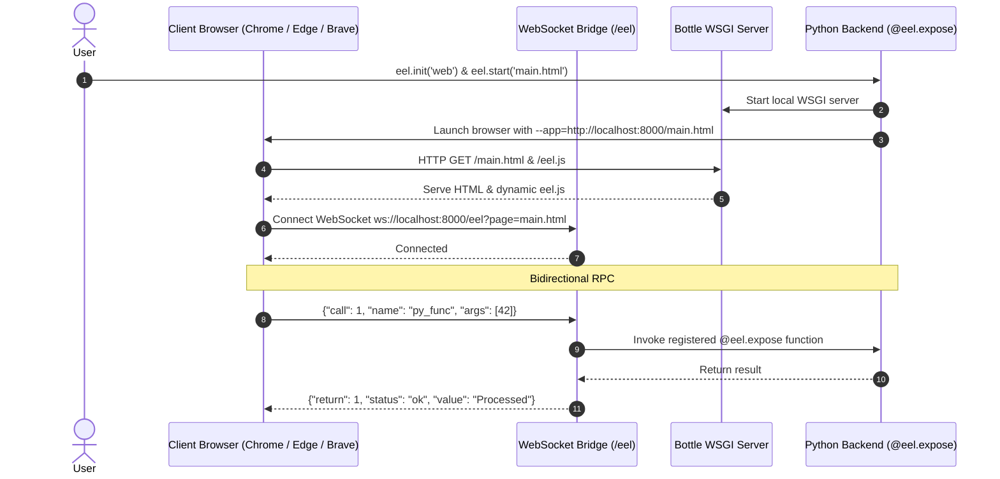

# Eel

[](https://pypi.org/project/Eel/)
[](https://pypi.org/project/Eel/)
[](https://mypy.readthedocs.io/)
[](https://github.com/python-eel/Eel/actions)
[](https://opensource.org/licenses/MIT)

> [!NOTE]
> **Project Status: Revived & Modernized (v0.19.0)**  
> This project has been modernized and revived with PEP 517/621 packaging, full Python 3.9–3.13 runtime support, modernized Gevent/Greenlet concurrency, cross-platform browser support (Chrome, Edge, Brave, Chromium), strict static type safety, and security hardening. See the [Archaeology Report](docs/revival/ARCHAEOLOGY_REPORT.md) and [Modernization Report](docs/revival/MODERNIZATION_REPORT.md).

Eel is a lightweight Python library for building Electron-like desktop GUI applications using web technologies (HTML, CSS, JavaScript) backed by Python's full ecosystem.

> **Eel hosts a local Bottle web server, establishes a WebSocket bridge, and lets you annotate functions so they can be called seamlessly across Python and JavaScript.**

<p align="center"></p>

---

## Table of Contents

- [Why Eel?](#why-eel)
- [Architecture](#architecture)
- [Requirements](#requirements)
- [Installation](#installation)
- [Quick Start](#quick-start)
- [Core Concepts](#core-concepts)
  - [Directory Structure](#directory-structure)
  - [Starting the Application](#starting-the-application)
  - [Supported Browsers](#supported-browsers)
  - [Exposing Functions (Python & JavaScript)](#exposing-functions)
  - [Return Values & Promises](#return-values--promises)
  - [Asynchronous Greenlets](#asynchronous-greenlets)
- [Packaging for Distribution (PyInstaller)](#packaging-for-distribution-pyinstaller)
- [Docker Support](#docker-support)
- [Development & Testing](#development--testing)
- [Documentation & Reports](#documentation--reports)
- [License](#license)

---

## Why Eel?

Building desktop GUI applications in Python is often heavy and complex:
- **Electron** requires bundling entire Node.js and Chromium runtimes (>150MB).
- **CEFPython / Qt** requires large, complex C/C++ bindings.
- **Tkinter** has outdated UI widgets that don't match modern web styling.

Eel takes the hassle out of writing short, simple desktop applications:
1. **Zero-Boilerplate:** 3 lines of code start a desktop app.
2. **Web Technology Freedom:** Use standard HTML5, CSS3, JavaScript, React, Vue, Svelte, or Bootstrap without custom build configurations.
3. **Seamless RPC:** Annotate with `@eel.expose` in Python or `eel.expose()` in JS; functions are directly callable from the other language with automatic promise/callback handling.
4. **Lightweight Distribution:** Reuses the user's existing Chrome, Edge, or Chromium browser in frameless App Mode (`--app`), keeping app bundles small.

---

## Architecture

Eel coordinates a lightweight local WSGI server, WebSocket JSON-RPC bridge, and browser launcher:



---

## Requirements

- **Python:** 3.9, 3.10, 3.11, 3.12, or 3.13
- **Operating System:** macOS, Linux, or Windows 10/11
- **Browser (for App Mode):** Any Chromium-based browser (Google Chrome, Microsoft Edge, Brave, or Chromium). If no Chromium browser is present, Eel falls back to opening the system default browser.

---

## Installation

Install via `pip`:

```bash
pip install eel
```

To include Jinja2 HTML templating support:

```bash
pip install eel[jinja2]
```

To install test and development dependencies:

```bash
pip install eel[test,all]
```

---

## Quick Start

### 1. Directory Structure

```text
my_app/
├── app.py
└── web/
    ├── index.html
    ├── style.css
    └── main.js
```

### 2. Frontend (`web/index.html`)

```html
<!DOCTYPE html>
<html>
<head>
    <title>My Eel Application</title>
    <!-- Dynamic script injected by Eel at runtime -->
    <script type="text/javascript" src="/eel.js"></script>
    <script type="text/javascript">
        // Expose JavaScript function to Python
        eel.expose(greet_from_js);
        function greet_from_js(name) {
            console.log("Hello " + name + " from JavaScript!");
        }

        async function callPython() {
            // Call Python exposed function and await return value
            let result = await eel.add_numbers(15, 27)();
            document.getElementById("output").innerText = "Result: " + result;
        }
    </script>
</head>
<body>
    <h1>My Eel Desktop App</h1>
    <button onclick="callPython()">Calculate in Python</button>
    <p id="output">Click to calculate</p>
</body>
</html>
```

### 3. Backend (`app.py`)

```python
import eel

# Initialize the static web folder
eel.init('web')

# Expose Python function to JavaScript
@eel.expose
def add_numbers(a: int, b: int) -> int:
    return a + b

# Start the application window
eel.start('index.html', size=(600, 400))
```

Run your app:

```bash
python app.py
```

---

## Supported Browsers

Eel supports multiple browser runtimes:
- **`mode='chrome'` (default):** Automatically discovers Google Chrome, Chromium, or Brave Browser across macOS, Linux, and Windows, launching with `--app=URL` mode.
- **`mode='edge'`:** Automatically discovers Microsoft Edge across macOS, Linux, and Windows in app mode.
- **`mode='electron'`:** Launches an Electron executable if installed.
- **`mode='custom'`:** Executes any custom command-line launcher passed via `cmdline_args`.
- **`mode=None` or `mode=False`:** Starts the Bottle WSGI web server without launching a browser window (ideal for headless testing or background services).

---

## Return Values & Promises

### Calling Python from JavaScript
In JavaScript, exposed Python calls return a function that returns a Promise:

```javascript
async function fetchServerData() {
    let data = await eel.get_user_profile(42)();
    console.log("User:", data);
}
```

### Calling JavaScript from Python
In Python, exposed JavaScript calls support both asynchronous callbacks and synchronous returns:

```python
# 1. Asynchronous callback
eel.js_random()(lambda result: print("Random number from JS:", result))

# 2. Synchronous return
result = eel.js_random()()
print("Synchronous result:", result)
```

---

## Asynchronous Greenlets

Eel uses Gevent for cooperative multitasking. Avoid `time.sleep()` which blocks the Gevent event loop; instead, use `eel.sleep()` and `eel.spawn()`:

```python
import eel

eel.init('web')

def background_worker():
    while True:
        eel.sleep(2.0)
        # Push update to all connected frontend clients
        eel.update_status("Heartbeat from Python")

eel.spawn(background_worker)
eel.start('index.html')
```

---

## Packaging for Distribution (PyInstaller)

To build a standalone executable that runs without requiring Python installed:

1. Install PyInstaller:
   ```bash
   pip install pyinstaller
   ```
2. Run the packaging utility:
   ```bash
   python -m eel app.py web --onefile --noconsole
   ```
   Or use the bundled console command:
   ```bash
   eel-pack app.py web --onefile --noconsole
   ```
3. Your standalone executable will be generated in `dist/`.

---

## Docker Support

Run Eel in containerized web-service mode:

```bash
docker compose up --build
```
Open `http://localhost:8000` in your browser.

---

## Development & Testing

1. **Set up local development environment:**
   ```bash
   ./scripts/setup_dev.sh
   ```

2. **Run strict static type analysis (MyPy):**
   ```bash
   mypy --strict eel
   ```

3. **Run automated test suite:**
   ```bash
   pytest tests/unit tests/integration/test_server_e2e.py -v
   ```
   Or run the full test suite script:
   ```bash
   ./scripts/run_tests.sh
   ```

---

## Documentation & Reports

Detailed technical documentation and revival audit reports:
- [Archaeology Report](docs/revival/ARCHAEOLOGY_REPORT.md) — Historical investigation, root causes of abandonment, and architecture.
- [Dependency Audit](docs/revival/DEPENDENCY_AUDIT.md) — Dependency analysis and version upgrade justifications.
- [Implementation Plan](docs/revival/IMPLEMENTATION_PLAN.md) — Structured modernization phases and completion criteria.
- [Security Audit](docs/revival/SECURITY_AUDIT.md) — Vulnerability analysis and security hardening details.
- [Testing Report](docs/revival/TESTING_REPORT.md) — Unit and end-to-end verification results.
- [Modernization Report](docs/revival/MODERNIZATION_REPORT.md) — Architectural modernization overview.
- [Known Limitations](docs/revival/KNOWN_LIMITATIONS.md) — Design boundaries and concurrency notes.
- [Architecture Map](docs/architecture/ARCHITECTURE.md) — Component architecture and sequence diagrams.

---

## License

This project is licensed under the [MIT License](LICENSE).
Attribution is preserved for original creator Chris Knott and the Python Eel Organisation.
