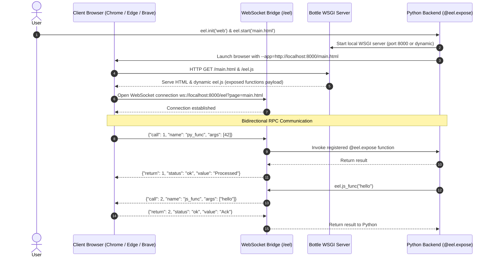

# Eel Architecture Documentation

## 1. System Overview

Eel bridges Python and web technologies by hosting a local WSGI server running on Bottle and Gevent-WebSocket, opening a local browser instance in App Mode, and facilitating bidirectional Remote Procedure Calls (RPC) over a persistent WebSocket connection.

---

## 2. Component Design

### 2.1 Python Core (`eel/__init__.py`)
- **`init(path, allowed_extensions, ...)`:**
  Scans the directory of static assets for JavaScript calls to `eel.expose()`. Binds proxy functions dynamically to module globals without `exec()`.
- **`start(*start_urls, mode, host, port, ...)`:**
  Sets up Bottle HTTP routing, binds WebSocket endpoint, resolves browser path, launches the browser process, and starts the Gevent server loop.
- **`expose(name_or_function)`:**
  Decorator registering Python functions in `_exposed_functions` dictionary for WebSocket invocation.
- **`_process_message(message, ws)`:**
  Dispatches incoming WebSocket JSON payloads, executing Python functions or resolving return value callbacks for JavaScript calls.

### 2.2 Frontend Bridge (`eel/eel.js`)
- Injected on the web page, initializing `window.eel`.
- Provides `eel.expose(func, name)` in JavaScript.
- Connects WebSocket on DOMContentLoaded.
- Translates `await eel.py_function(args)()` into promises resolved when Python sends back the return message.

### 2.3 Browser Launchers (`eel/browsers.py`)
- Abstract interface delegating to browser-specific modules:
  - `eel.chrome`: Google Chrome, Chromium, Brave Browser
  - `eel.edge`: Microsoft Edge (Chromium-based)
  - `eel.electron`: Electron standalone binaries
  - `eel.msIE`: Legacy Edge IE compatibility redirect

