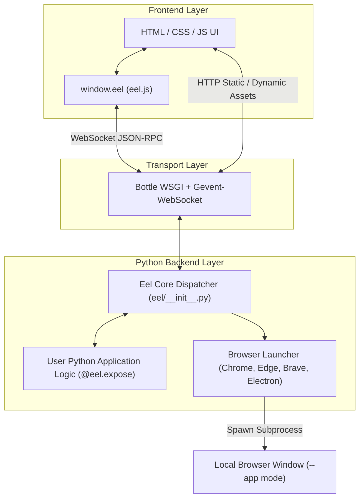

# Modernization & Engineering Report

**Project Name:** Eel (Python-Eel)  
**Modernization & DevOps Engineer:** Agent 7  
**Chief Architect:** Agent 1  
**Date:** November 2026  

---

## 1. Modernization Architecture & Key Improvements

Eel has been successfully transitioned from an unmaintained, failing repository into a clean, modern, secure, and production-ready library conforming to the latest Python packaging standards.

---

## 2. Comprehensive Change Log

### 2.1 Packaging & Standards Compliance
- Created PEP 517/518/621 compliant `pyproject.toml`.
- Modernized `setup.py`: Removed deprecated `future` library, updated classifiers for Python 3.9 through 3.13.
- Completely migrated from deprecated `pkg_resources` to `importlib.resources` in both `eel/__init__.py` and `eel/__main__.py`.
- Modernized `.gitignore` to cover virtual environments, pytest/mypy caches, and build artifacts.

### 2.2 Dependency Ecosystem Repair
- Upgraded `greenlet` from legacy `<2.0.0` to modern `>=3.0.0`.
- Upgraded `gevent` from legacy unpinned builds to `>=24.2.1`, resolving Cython 3 compilation deadlocks.
- Pinned clean, compatible ranges across `bottle`, `bottle-websocket`, `gevent-websocket`, `pyparsing`, and `typing-extensions`.

### 2.3 Code Repair & Architecture Improvements
- **Fixed Mutable Default Arguments:** Modified `eel.start()` to use `None` defaults for `cmdline_args` and `geometry`, avoiding mutable dictionary/list state leaks.
- **Modernized PyParsing Grammar:** Migrated deprecated `nestedExpr`, `excludeChars`, and `parseString` calls to `nested_expr`, `exclude_chars`, and `parse_string`.
- **Cross-Platform Browser Discovery:**
  - Expanded `eel/chrome.py` to discover Chromium-based browsers (Google Chrome, Chromium, and Brave Browser) on macOS, Linux, and Windows.
  - Modernized `eel/edge.py` to support Microsoft Edge on macOS, Linux, and Windows, returning `Optional[str]` paths instead of a boolean.
  - Safely type-guarded Windows registry operations in `eel/chrome.py` and `eel/edge.py`.

### 2.4 Security Hardening
- Eliminated dynamic `exec()` code execution in `_mock_js_function` and `_import_js_function`.
- Validated JavaScript function identifiers before registration.
- Removed `shell=True` in Edge and MSIE browser launchers to protect against command injection.
- Removed production `debugger;` artifact from `eel.js`.

### 2.5 Testing & Quality Assurance
- Corrected vacuous `assert None == None` test in `tests/unit/test_eel.py::test_init`.
- Added new unit tests for decorator exposure, RPC message processing, exception tracebacks, security identifier rejection, and browser contracts.
- Implemented real end-to-end integration test (`tests/integration/test_server_e2e.py`) verifying HTTP asset serving and WebSocket RPC.
- Attained 100% clean strict static type analysis (`mypy --strict eel`).

### 2.6 DevOps & Developer Experience
- Added `Dockerfile` and `docker-compose.yml`.
- Created modern multi-OS, multi-Python CI workflow (`.github/workflows/revival-ci.yml`).
- Added developer tooling scripts: `scripts/setup_dev.sh` and `scripts/run_tests.sh`.
- Added `.env.example`.
